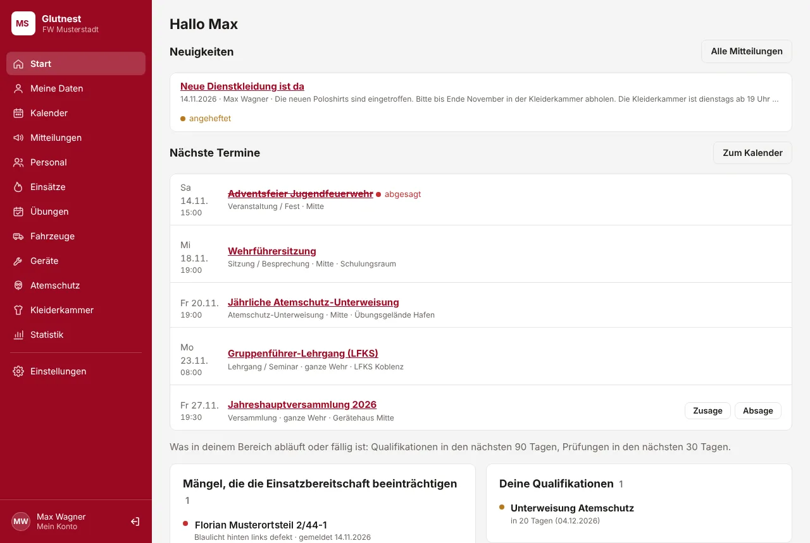
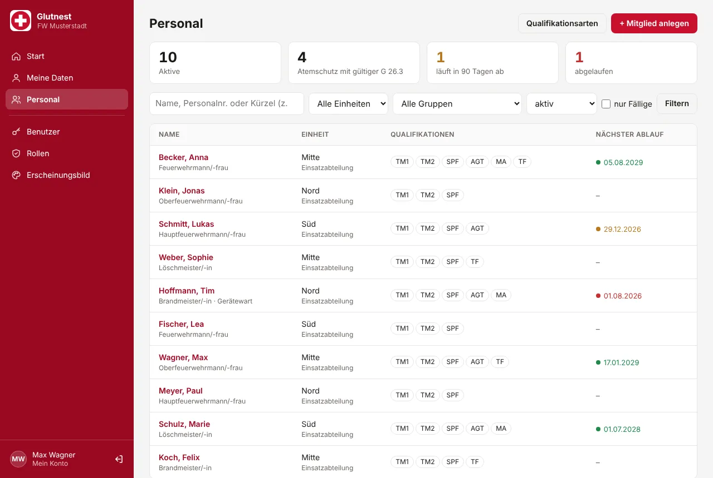
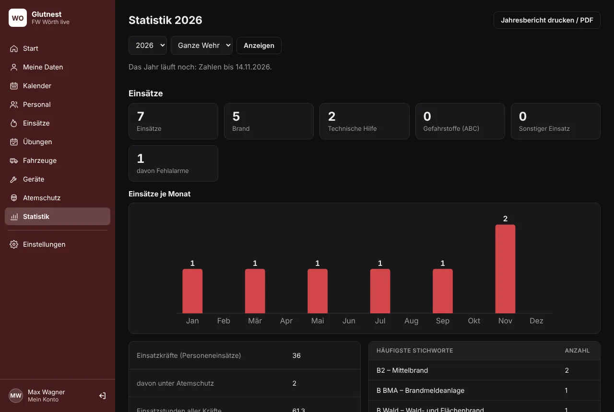

  

<h1 align="center">Glutnest</h1>

  <strong>Die Verwaltung für eure Feuerwehr. An einem Ort.</strong> 
  Personal, Einsätze, Übungen, Fahrzeuge, Geräte und Atemschutz in einer Anwendung im Browser. 
  Im eigenen Haus oder in der Cloud mit Hosting ausschließlich in Deutschland.

  <a href="https://glutnest.eu"><strong>glutnest.eu</strong></a> ·
  <a href="https://glutnest.eu/roadmap/">Roadmap</a> ·
  <a href="https://github.com/siliconserver/glutnest.eu/issues">Wünsche &amp; Fehler</a> ·
  <a href="https://glutnest.eu/#kontakt">Als Interessent vormerken</a>

> **Hinweis:** Glutnest ist ein privates Projekt in Entwicklung und noch nicht käuflich zu haben. Interessierte Wehren können sich [unverbindlich vormerken lassen](https://glutnest.eu/#kontakt).

## Warum Glutnest?

Was im Gerätehaus sonst in Ordnern, Listen und Köpfen steckt, liegt in Glutnest an einem Ort. Jedes Modul greift auf dieselben Stammdaten zu: Wer im Einsatz war, steht im Bericht, im Fahrtenbuch und im Atemschutznachweis, ohne dass es dreimal eingetippt wird. Glutnest läuft im Browser, am PC wie am Handy, und lässt sich als App auf den Startbildschirm legen.

## Funktionen

| | |
|---|---|
| **Personal & Qualifikationen** | Mitglieder, Dienstgrade, Funktionen, Lehrgänge und Ablaufdaten. Jedes Mitglied pflegt seine eigenen Daten. |
| **Einsatzberichte** | Kräfte, Fahrzeuge und Geräte erfassen, Freigabe von Entwurf über geprüft bis abgeschlossen, Druckansicht. |
| **Leitstellen-Import** | Einsätze aus iSE Cobra 4 im MAÜ-XML-Format von Rheinland-Pfalz übernehmen, ohne Daten zu Meldenden oder Patienten. |
| **Übungen & Dienste** | Dienstplanung je Standort und Gruppe, Anwesenheit per Antippen am Handy, Auswertung je Mitglied. |
| **Fahrzeuge** | Fristen wie HU und UVV, Fahrtenbuch und Mängelmeldungen mit Einsatzbereitschaft. |
| **Geräte & Prüfungen** | Inventar, Prüfarten nach DGUV und DIN, Prüfprotokolle, QR-Etiketten und Beladeplan. |
| **Atemschutz** | Geräteträger mit automatisch berechneter Einsatzbereitschaft aus Lehrgang, G 26.3, Belastungsübung und Unterweisung. |
| **Kalender** | Termine und Dienste mit Zu- und Absagen, persönliches Kalender-Abo für Handy und Outlook. |
| **Statistik & Jahresbericht** | Zahlen je Jahr und Standort, Jahresbericht für die Versammlung als PDF. |
| **Ehrungen & Jubiläen** | Ehrungskatalog des Landes vorbelegt, fällige Ehrungen und Jubiläen auf einen Blick. |
| **Fälligkeiten & Erinnerungen** | Die Startseite zeigt, was im eigenen Bereich abläuft, Erinnerungen kommen per Mail. |
| **Mitteilungen & Umfragen** | Neuigkeiten an die ganze Wehr oder einzelne Gruppen, Umfragen und Dokumentenablage. |
| **Kleiderkammer & PSA** | Ausgabe je Mitglied, Bestand, Lebensdauer und Prüfungen der Schutzausrüstung. |
| **Einsatzkarte** | Einsatzorte auf einer OpenStreetMap-Karte. |
| **Automatische Backups** | Tägliche, verschlüsselte Sicherung mit Meldung, wenn etwas schiefgeht. |

Hell- und Dunkelmodus, drei Oberflächen zur Wahl (Wache, Klar, Leitstand) sowie Logo und Farbe je Wehr sind selbstverständlich.

  
  

## Bei euch im Haus oder in der Cloud

- **On-Premises:** Glutnest läuft auf eurem eigenen Server, etwa bei der Verbandsgemeinde oder Stadt. Eine Wehr mit beliebig vielen Standorten, die Daten verlassen euer Netz nicht.
- **Cloud (geplant):** Wir betreiben Glutnest für euch, mit Hosting ausschließlich in Deutschland. Jede Wehr ist strikt von anderen getrennt, Backups und Updates sind inklusive.

## Sicherheit & Datenschutz

Feuerwehren verwalten Gesundheitsdaten, Bankverbindungen und Einsatzberichte. Deshalb gilt in Glutnest:

- Zwei-Faktor-Anmeldung für jedes Konto Pflicht
- Besonders sensible Daten zusätzlich verschlüsselt
- Lückenloses, manipulationssicheres Protokoll der Zugriffe
- Rollen mit Lese- und Schreibrechten je Modul und Standort
- Datensparsam von Anfang an, DSGVO ohne Kompromisse

## Wie geht es weiter?

Glutnest wird laufend weiterentwickelt. Was fertig ist und was als Nächstes kommt, zeigt die [Roadmap](https://glutnest.eu/roadmap/). Wünsche und Fehler nehmen wir gern über die [Issues](https://github.com/siliconserver/glutnest.eu/issues/new/choose) entgegen. Bitte dabei keine echten Personendaten eintragen.

## Stand & Kontakt

Glutnest ist derzeit ein privates Projekt in Entwicklung. Der volle Umfang für den ersten Einsatz in einer Wehr ist noch nicht fertig, deshalb gibt es noch keinen Verkauf und keine Preise. Wer Interesse hat, kann sich unverbindlich über [kontakt@glutnest.eu](mailto:kontakt@glutnest.eu?subject=Interesse%20an%20Glutnest) vormerken lassen und erfährt als Erstes, wenn es losgeht. Mehr auf **[glutnest.eu](https://glutnest.eu)**.

---

Dieses Repository enthält die Webseite glutnest.eu und den öffentlichen Issue-Tracker. Glutnest selbst ist proprietäre Software. Hinweise zur Pflege der Webseite: [docs/webseite.md](docs/webseite.md) · [Impressum](https://glutnest.eu/impressum/) · [Datenschutz](https://glutnest.eu/datenschutz/)
